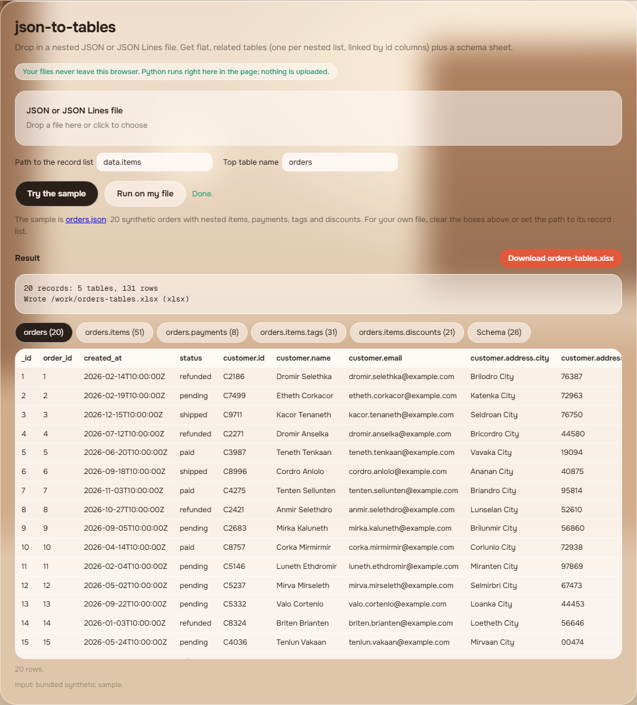

# json-to-tables

[](https://github.com/chasebuilds/json-to-tables/actions/workflows/ci.yml)  [](LICENSE)

**[Live demo: try it in your browser](https://chasebuilds.github.io/json-to-tables/)**. Drop in your own file or run the bundled sample with one click. The real package runs in the page with Pyodide, so files never leave your browser.

[](https://chasebuilds.github.io/json-to-tables/)

Turns nested JSON or JSON Lines (API exports, webhook dumps) into tidy related tables. Each list inside a record gets its own table with keys back to its parent row. Nested objects become dotted columns (`customer.address.city`). Every row in a table has the same columns, even when records have different keys. Numbers stay numbers and true/false stays true/false. Output is an Excel workbook (one sheet per table plus a Schema sheet), a folder of CSV files, or a SQLite database. Everything runs offline.

## Measured result

Invented order records were flattened, then every value was looked up again in the tables by following the parent keys. The table below is written by the benchmark script from a real run, not typed by hand. Method and limits: [BENCHMARK.md](BENCHMARK.md).

<!-- benchmark:start -->
| Measure | Result |
|---|---:|
| Records (invented orders) | 20,000 |
| Values in the input | 426,604 |
| Values found exactly once, at the right place | **100.0%** (426,604 of 426,604) |
| Values missing / extra | 0 / 0 |
| Child rows whose parent key points nowhere | 0 |
| Tables / rows made | 5 / 123,829 |
| SQLite row counts match the tables | yes |
| Speed (flatten only) | **41,694 records/sec** |
<!-- benchmark:end -->

## Example

Input (`samples/orders.json`, shortened):

```json
{"data": {"items": [
  {"order_id": 3, "status": "shipped",
   "customer": {"name": "Kacor Tenaneth", "address": {"city": "Seldroan City", "zip": "76750"}},
   "items": [{"sku": "SKU-913", "qty": 2, "price": 84.48, "tags": ["rush", "bulk"]}]}
]}}
```

```
j2t flatten samples/orders.json -o samples/orders.xlsx --root data.items --name orders
```

Sheets in the workbook:

| Sheet | Columns |
|---|---|
| orders | `_id`, `order_id`, `status`, `customer.name`, `customer.address.city`, `customer.address.zip`, ... |
| orders.items | `_id`, `_parent_id` (row in orders), `_index` (position in the list), `sku`, `qty`, `price` |
| orders.items.tags | `_id`, `_parent_id` (row in orders.items), `_index`, `value` |
| Schema | `table`, `full_name`, `column`, `json_path` (like `items[].tags[]`), `type`, `filled` |

To join line items back to their order, match `orders.items._parent_id` to `orders._id`.

## Quick start

Windows (on macOS or Linux use `.venv/bin/` in place of `.venv\Scripts\`):

```
python -m venv .venv
.venv\Scripts\python -m pip install -e .
.venv\Scripts\j2t flatten samples\orders.json -o samples\orders.xlsx --root data.items --name orders
```

The sample is 20 generated orders. The command prints:

```
20 records: 5 tables, 131 rows
Wrote samples\orders.xlsx (xlsx)
```

| Option | Effect |
|---|---|
| `-o PATH` | `.xlsx` for a workbook, `.db` / `.sqlite` for SQLite, anything else is a folder of CSV files (default `tables.xlsx`) |
| `--root PATH` | dotted path to the list of records, like `data.items` (list positions work too: `pages.0.rows`) |
| `--name NAME` | name of the top table (default: last part of `--root`, or `root`) |

Input ending in `.jsonl` or `.ndjson` is read one record per line. With `--root`, the path is followed inside each line. A `.json` file that is a list gives one record per item; a single object is one record.

Exit codes: `0` done, `2` the file could not be read or `--root` was not found.

## Output rules

| Rule | Detail |
|---|---|
| Lists | each list becomes a child table named `parent.key`, rows carry `_parent_id` and `_index` |
| Objects | flattened into the same row as dotted columns |
| Plain values in a list | go in a column named `value` |
| Differing keys | columns are the union across records, in first-seen order; missing cells are empty |
| Types | Excel and SQLite keep numbers, true/false and text; CSV writes `true`/`false` |
| Text starting with `=` | stays text in Excel, never runs as a formula |
| Long names | sheet names are cut to Excel's 31 characters and kept unique; the Schema sheet maps them back |

As a library:

```python
from json_to_tables import flatten
from json_to_tables.write import write
from pathlib import Path

tables = flatten(records, "orders")
tables["orders.items"].header()   # ['_id', '_parent_id', '_index', 'sku', 'qty', 'price']
write(tables, Path("out.db"))
```

## Limits

Short version: it reshapes, it does not clean. Keys that contain a dot can collide with nested keys, and missing and `null` both end up as an empty cell in files. The whole file is read into memory. Full list: [LIMITATIONS.md](LIMITATIONS.md).

## Development

```
.venv\Scripts\python -m pip install -e ".[dev]"
.venv\Scripts\python -m pytest --cov
.venv\Scripts\python -m ruff check .
.venv\Scripts\python -m mypy
.venv\Scripts\python -m benchmark.run_benchmark
```

The sample file was made with `python -m benchmark.generate --seed 7 --count 20 --out samples/orders.json`.

## License

MIT. See [LICENSE](LICENSE).

## More from Chase Builds

- **[excel-to-sql](https://github.com/chasebuilds/excel-to-sql)**: Load CSV and Excel into SQL with type inference and a load report. ([live demo](https://chasebuilds.github.io/excel-to-sql/))
- **[product-matcher](https://github.com/chasebuilds/product-matcher)**: Match products between two lists by SKU, units and fuzzy names. ([live demo](https://chasebuilds.github.io/product-matcher/))
- **[business-research-tool](https://github.com/chasebuilds/business-research-tool)**: Company research sheets where every fact has a source.

[All projects, sorted by industry](https://github.com/chasebuilds) · [chasebuilds.github.io](https://chasebuilds.github.io)
